# Manual de los plugins

Para instalarlos, consulta la [Guía de instalación](INSTALACION.md).

| Plugin | Para qué |
|---|---|
| [MasterChain](#masterchain) | Masterizar: la cadena completa en un solo plugin, con medición profesional |
| [MC Limiter · MC BusComp · MC Saturator · MC Imager · MC Clipper · MC Meter](#módulos-sueltos-mc) | Cada etapa de MasterChain como plugin independiente |
| [PrismaEQ](#prismaeq) | Ecualizar con precisión, de forma estática o dinámica |
| [OptoComp](#optocomp) | Compresión óptica suave y musical: voces, bajo, buses |
| [Furia](#furia) | Compresión con carácter, de la sutil a la destructiva, con saturación |
| [Afina](#afina) | Corrección de afinación de voces en tiempo real |

> **Convenciones.** En todos los plugins: doble clic en una perilla la devuelve a su valor por defecto; la latencia se reporta al DAW, que la compensa; y los ajustes se guardan con el proyecto.

---

## MasterChain

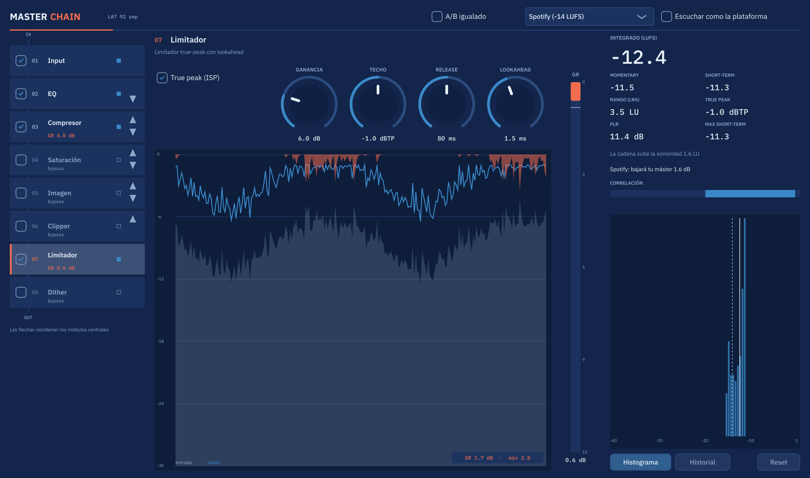

### Qué hace

Es una cadena de mastering completa: lleva una mezcla terminada al nivel, el tono y el rango dinámico adecuados para publicarla, sin superar el techo de picos que exigen las plataformas. Incluye ocho etapas y un medidor de sonoridad según el estándar EBU R128.

```
IN → 01 Input → [02 EQ · 03 Compresor · 04 Saturación · 05 Imagen · 06 Clipper] → 07 Limitador → 08 Dither → OUT
                 └──────────────── orden libre, con las flechas ────────────────┘
```

### Cómo lo hace

- **Orden protegido.** La entrada va siempre la primera; el limitador y el dither, siempre los últimos. Así no se puede saturar después del limitador (los picos nuevos romperían el techo) ni aplicar dither antes de procesar. El orden de las etapas centrales se cambia con las flechas.
- **Cada módulo se activa por separado** con su casilla. Un módulo en bypass retrasa la señal lo mismo que si procesara, y el cambio se hace con un fundido de 20 ms: activar y desactivar no produce clics ni desalinea la pista. Un test lo verifica muestra a muestra.
- **Medición EBU R128 / ITU-R BS.1770-4**, validada con los casos oficiales EBU Tech 3341 y 3342: sonoridad momentánea (400 ms), a corto plazo (3 s) e integrada, rango de sonoridad (LRA), true peak (pico real entre muestras), PLR y correlación de fase.

### La barra superior

| Control | Qué hace |
|---|---|
| **A/B igualado** | Escuchas el original **a la misma sonoridad** que el procesado. Sirve para comparar el sonido sin que el volumen te engañe: lo más fuerte siempre parece mejor |
| **Plataforma** | Elige el destino (Spotify −14 LUFS, Apple Music −16, YouTube −14, Tidal −14, Amazon −14, Deezer −15). El medidor indica cuánto bajará la plataforma tu máster |
| **Escuchar como la plataforma** | Aplica esa bajada a la escucha. **Desactívalo antes de exportar**: mientras esté activo, la ventana muestra un aviso coral |

### Los módulos

**01 · Input.** Prepara la señal.
- *Ganancia* (±24 dB): ajusta el nivel de entrada.
- *Subsónico*: Off, DC (5 Hz), 20 Hz o 30 Hz, a 24 dB/oct. Elimina energía inaudible que se come margen del limitador. 20 Hz es seguro en casi cualquier música.
- *Invertir L/R*: corrige un canal con la polaridad invertida.
- *Escuchar en mono*: comprueba que la mezcla funciona en un altavoz mono (móviles, bares).

**02 · EQ.** Es el [PrismaEQ](#prismaeq) completo, con todas sus funciones. En mastering, usa **Fase lineal** para no desplazar la fase de los graves.

**03 · Compresor.** Compresor de bus tipo VCA para dar cohesión ("glue").
- *Threshold* (−40 a 0 dB), *Ratio* (1:1 a 10:1), *Attack* (0,1–100 ms), *Release* (20–1500 ms), *Knee* (0–12 dB), *Makeup* y *Mix* (compresión en paralelo).
- *Release automático*: el release se alarga cuando la compresión se mantiene (hasta ~1,6 s) y se acorta tras los transitorios (~300 ms). Es lo más musical en un bus.
- *SC HPF* (por defecto 90 Hz): filtra los graves de la señal que controla el compresor, para que el bombo no haga "bombear" la mezcla entera.
- *Visualización*: historial de 8 s con el nivel de entrada (relleno), el de salida (línea) y la reducción de ganancia en coral, colgando desde arriba.
- **Punto de partida para glue:** ratio 2:1, attack 10–30 ms, release automático, threshold hasta que el GR marque 1–2 dB.

**04 · Saturación.** Añade densidad y armónicos. Funciona sobremuestreada a 4x, sin aliasing.
- *Modo*: **Cinta** (satura antes los agudos, redondea los transitorios), **Válvula** (asimétrica, 2.º armónico, cálida) o **Transformador** (satura sobre todo los graves: peso).
- *Drive* (0–24 dB), *Mix*, *Output* y *Compensar nivel*, que mantiene el volumen igual para que juzgues el color y no el volumen.
- La curva de transferencia muestra cómo se dobla la señal, con un punto que sigue tu nivel en vivo: si el punto entra en la zona curva, estás saturando.

**05 · Imagen.** Controla el estéreo.
- *Ancho* (0–200 %): 100 % no cambia nada; por encima abre la imagen y por debajo la estrecha.
- *Graves en mono* (Off, 20–300 Hz): por debajo de esa frecuencia, el contenido lateral se elimina con un filtro Linkwitz-Riley de 24 dB/oct. Da graves más firmes y evita problemas en vinilo y en sistemas mono. Entre 100 y 150 Hz es habitual.
- El goniómetro muestra la imagen: una línea vertical es mono; una nube ancha, mucho estéreo; si se tumba en horizontal, hay problemas de fase. La correlación debe quedarse en positivo.

**06 · Clipper.** Recorta los transitorios más rápidos (por ejemplo, los picos del bombo y la caja) antes del limitador, para que este trabaje menos y suene más transparente. Funciona sobremuestreado a 4x.
- *Drive* (0–12 dB), *Techo* (−6 a 0 dB) y *Suavidad* (0 % = recorte duro, 100 % = curva suave).
- **Uso:** sube el drive hasta que el medidor CLIP marque 1–2 dB en los golpes. Si oyes distorsión, baja el drive o sube la suavidad.

**07 · Limitador.** El último control de nivel: sube la sonoridad sin que ningún pico supere el techo.
- *Ganancia* (0–24 dB): cuánto empujas contra el techo. Es el control de sonoridad final.
- *Techo* (−12 a 0 dBTP): **−1 dBTP** para plataformas de streaming.
- *Release* (1–1000 ms): corto es más fuerte pero distorsiona los graves; largo es más limpio pero puede "bombear".
- *Lookahead* (0,5–10 ms): margen para anticipar los picos.
- *True peak (ISP)*: detecta también los picos **entre muestras**, que aparecen al convertir a analógico o a MP3/AAC. Mantenlo activado.
- **Cómo funciona:** el techo está garantizado por construcción (lookahead con mínimo deslizante y media móvil). Con toda la cadena forzada al máximo, el test mide −0,998 dBTP con un techo de −1.

**08 · Dither.** Solo al exportar a 16 o 24 bits.
- *Resolución*: 16 bits (CD), 20 o 24 bits (streaming y distribuidoras).
- *Noise shaping*: desplaza el ruido del dither a frecuencias donde el oído es menos sensible. Úsalo en 16 bits.
- Exportando en 32 bits flotantes no hace falta: déjalo en bypass.

### El medidor (panel derecho)

| Lectura | Qué significa |
|---|---|
| **Integrado** | Sonoridad media de toda la canción. Es lo que comparan las plataformas. Azul cielo: a ±1 LU del objetivo; coral: lejos del objetivo |
| **Momentary / Short-term** | Sonoridad de los últimos 0,4 s / 3 s |
| **LRA** | Rango de sonoridad: cuánta dinámica tiene la canción entre secciones. Pop y EDM: 3–6 LU; acústico y clásica: 8–15 LU |
| **True peak** | El pico real máximo. Coral si supera −1 dBTP |
| **PLR** | Distancia entre el pico y la sonoridad. Menos de 8 dB suele indicar un máster sobrecomprimido |
| **Correlación** | +1 es mono, 0 es muy ancho y negativo indica problemas de fase |
| **Histograma** | Cómo se reparte la sonoridad a corto plazo. Un pico estrecho y pegado a la derecha es un máster aplastado; una campana ancha conserva dinámica. La línea blanca es el integrado; la discontinua, el objetivo de la plataforma |
| **Historial** | La sonoridad de los últimos 60 s |

**Reset** reinicia la medición: púlsalo antes de reproducir la canción completa para medir el integrado.

### Flujo de trabajo recomendado

1. **Input**: subsónico a 20 Hz y ganancia para que los picos queden en torno a −6 dBFS.
2. **EQ** en fase lineal: correcciones amplias de ±1–2 dB. Si algo hay que corregir más, conviene volver a la mezcla.
3. **Compresor**: 1–2 dB de reducción, solo si la mezcla necesita cohesión.
4. **Saturación**, opcional: drive bajo y Mix al 30–50 %.
5. **Imagen**: graves en mono a ~120 Hz y el ancho con moderación.
6. **Clipper**: 1–2 dB en los golpes.
7. **Limitador**: techo −1 dBTP; sube la ganancia hasta el integrado que buscas.
8. **A/B igualado**: comprueba que el procesado **suena mejor**, no solo más fuerte.
9. **Pulsa Reset**, reproduce la canción entera y lee el integrado, el true peak y el PLR.
10. **Exporta.** Si exportas a 16 o 24 bits, activa el dither.

> **¿Cuánto subir?** Para streaming, entre −14 y −9 LUFS integrados. Más alto no suena más fuerte en Spotify, porque la plataforma baja tu máster. Lo único que consigues es perder dinámica. El medidor te dice cuánto lo bajará.

---

## Módulos sueltos (MC)

Cada etapa de MasterChain existe también como plugin independiente, **con el mismo procesamiento y la misma interfaz**, más medidores de entrada y salida a los lados. Son útiles cuando solo necesitas una herramienta: un limitador en un bus o un medidor al final de la mezcla.

| Plugin | Equivale a | Usos fuera del mastering |
|---|---|---|
| **MC Limiter** | Módulo 07 | Controlar picos de buses (batería, voces); proteger una salida |
| **MC BusComp** | Módulo 03 | Glue en el bus de batería, en el bus de mezcla o en un grupo de guitarras |
| **MC Saturator** | Módulo 04 | Calentar bajo, voces o una batería entera; densidad en buses |
| **MC Imager** | Módulo 05 | Ensanchar pads y coros; poner en mono los graves de un sintetizador |
| **MC Clipper** | Módulo 06 | Recortar transitorios de bombo y caja para ganar nivel en la batería |
| **MC Meter** | El medidor | Medir la sonoridad de cualquier pista o de la mezcla final |

| | | |
|---|---|---|
| 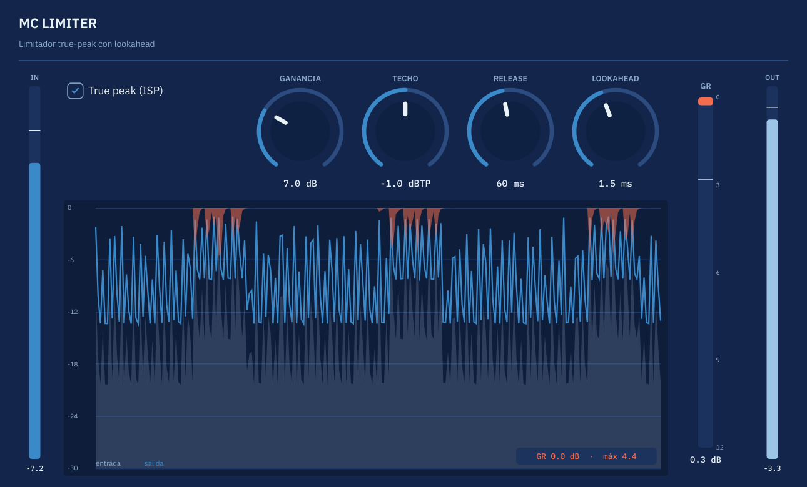 | 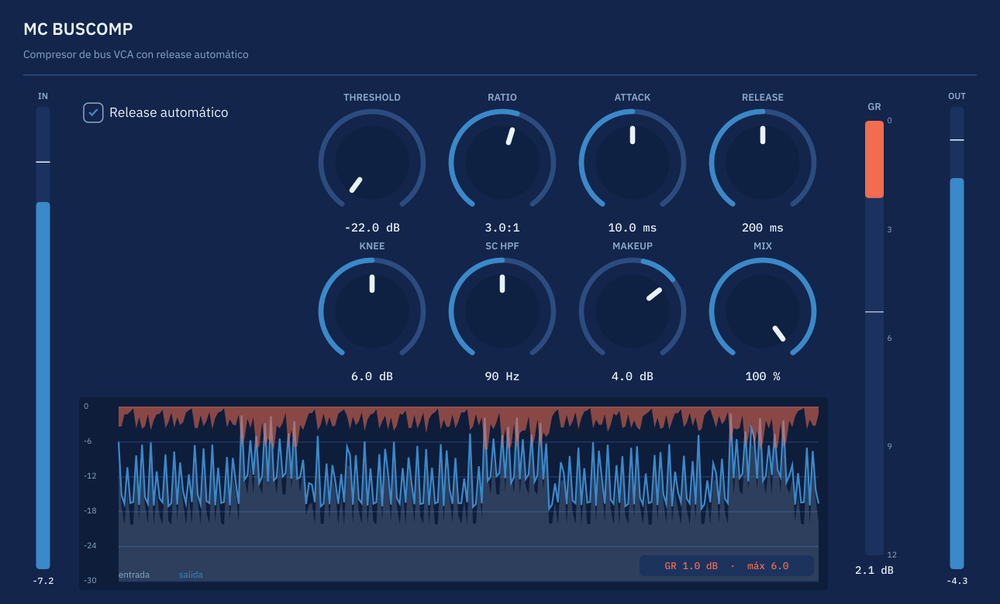 | 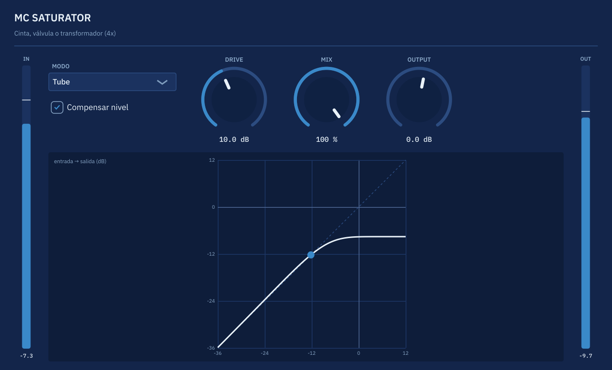 |
| 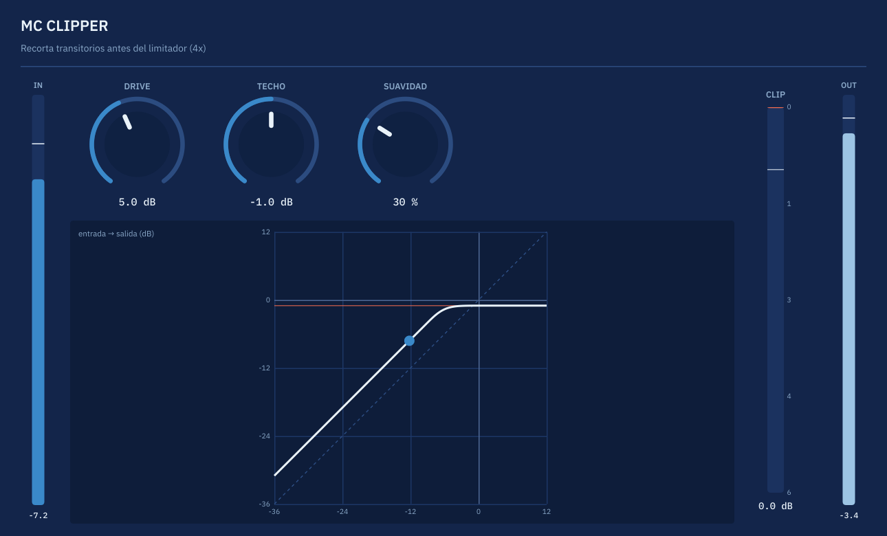 | 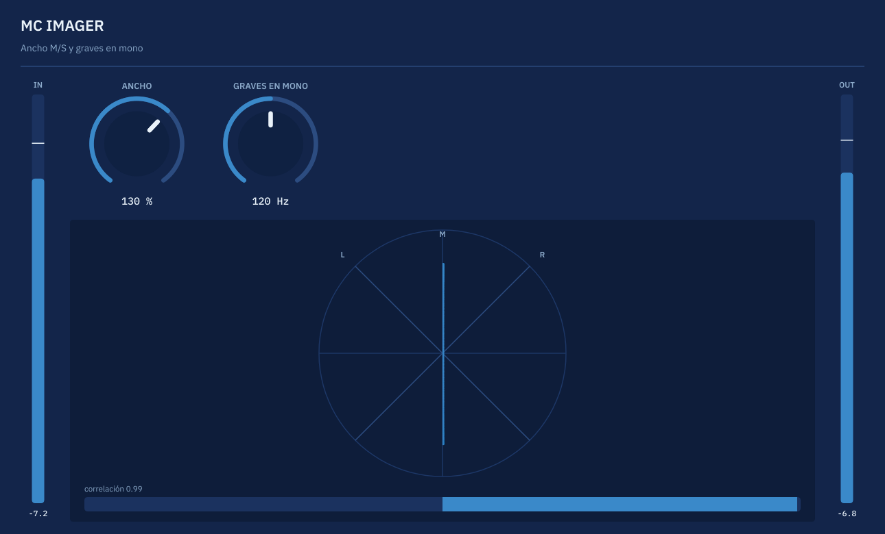 | 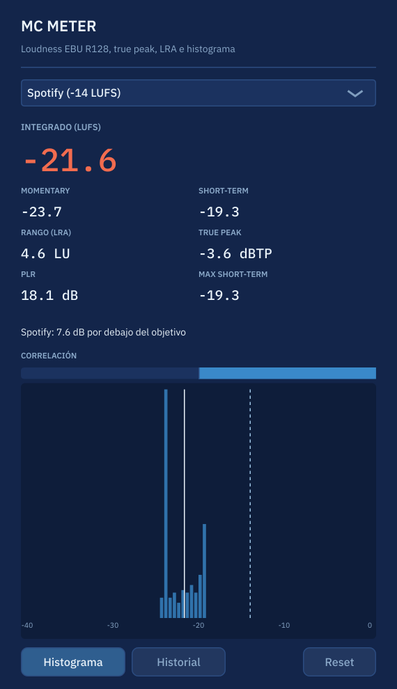 |

---

## PrismaEQ

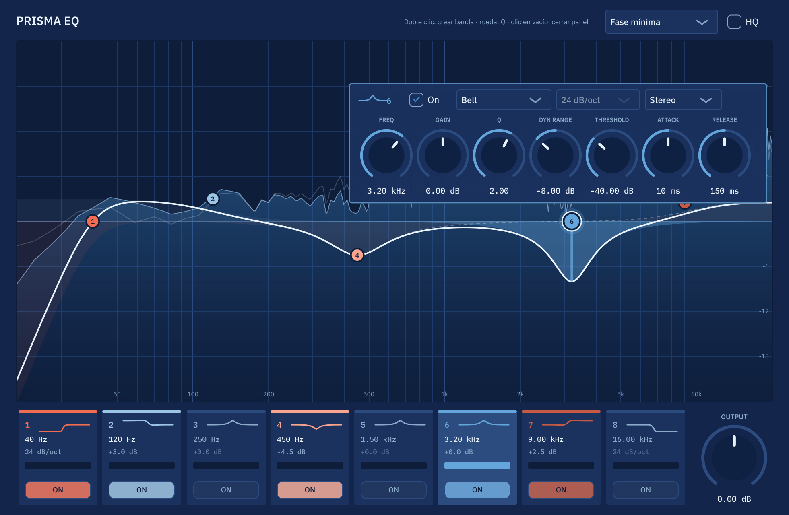

### Qué hace

Es un ecualizador paramétrico de 8 bandas que puede trabajar de forma **estática** (como cualquier EQ) o **dinámica**: una banda actúa solo cuando su zona de frecuencias supera un umbral. Incluye un analizador de espectro y modo de **fase lineal**.

### Cómo lo hace

- **Filtros SVF trapezoidales** (Zavalishin/Simper): estables aunque la ganancia cambie en cada muestra, que es lo que exige un EQ dinámico. La curva dibujada es **exactamente** la que se aplica al audio: un test lo verifica con un error de 0,000 dB.
- **Bandas dinámicas**: un detector pasa-banda centrado en la propia banda mide el nivel. Por encima del umbral, la ganancia se desplaza hasta el *Dyn Range*.
- **HQ**: procesa a 2x. A 44,1/48 kHz, las campanas agudas se estrechan cerca de Nyquist (cramping); HQ lo corrige.
- **Fase lineal**: un filtro FIR de 16384 coeficientes, diseñado en segundo plano. No desplaza la fase y sigue la curva con un error de 0,006 dB. Procesa Mid y Side por separado.

### Manejo

- **Doble clic** en el gráfico crea una banda (un corte en los extremos, una campana en el centro). **Doble clic en un nodo** la apaga.
- **Arrastra** un nodo para cambiar frecuencia y ganancia; con la **rueda del ratón** sobre él cambias la Q.
- Al seleccionar un nodo se abre su **panel flotante** con todos sus controles. Un clic en una zona vacía lo cierra.
- La **tira inferior** muestra las 8 bandas: forma, valores, medidor dinámico y ON.
- Al pasar el ratón se lee la **frecuencia, la nota y los cents**. Sirve para localizar una resonancia y saber qué nota es.

### Controles de cada banda

| Control | Rango | Notas |
|---|---|---|
| Tipo | Campana, Low Shelf, High Shelf, Low Cut, High Cut, Notch | |
| Pendiente | 12, 24, 36 o 48 dB/oct | Solo en los cortes |
| Ubicación | Stereo, Mid, Side, Left, Right | Mid = el centro (voz, bombo, bajo); Side = los lados (ambiente, guitarras abiertas) |
| Freq / Gain / Q | 10 Hz–30 kHz / ±30 dB / 0,1–18 | |
| Dyn Range | ±24 dB | 0 = banda estática; negativo = comprime esa zona; positivo = la expande |
| Threshold / Attack / Release | −60 a 0 dB / 0,1–200 ms / 5–2000 ms | Solo en las bandas dinámicas |

### Recetas

| Objetivo | Ajuste |
|---|---|
| **De-esser** | Campana a 6–8 kHz, Q 2–4, Dyn Range −6 dB, threshold hasta que solo reaccione en las "s" |
| **Bajo que retumba en ciertas notas** | Campana en la nota problemática (búscala con la lectura del cursor), Q 3–5, Dyn Range −4 dB |
| **Voz que se pierde en el estribillo** | Campana a 2–4 kHz, Dyn Range +3 dB y threshold alto: la presencia sube solo cuando hace falta |
| **Ensanchar sin desordenar** | High Shelf en **Side** a 8 kHz, +2 dB |
| **Limpiar graves** | Low Cut a 30–40 Hz, 24 dB/oct |

---

## OptoComp

| T-2 (válvula) | T-3 (estado sólido) |
|---|---|
| 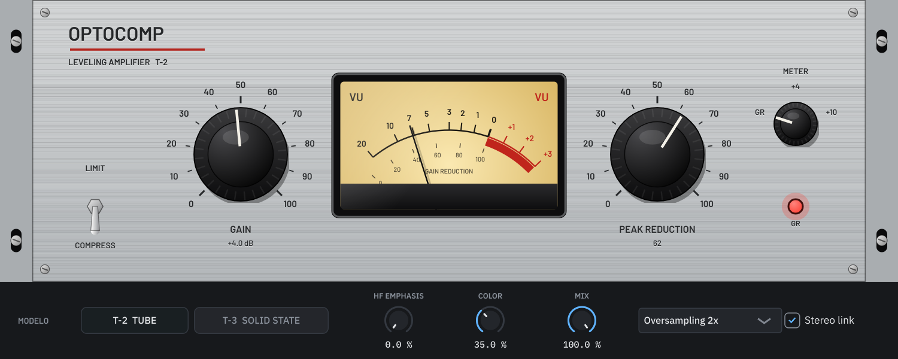 | 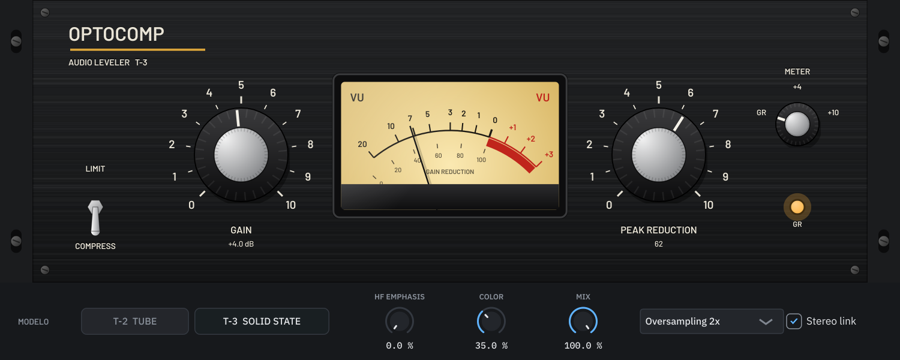 |

### Qué hace

Es un compresor óptico, el tipo de compresor más "musical": reacciona de forma suave, sin que se note que está trabajando. Tiene dos modelos, elegibles en la barra inferior:

- **T-2 Tube**: lento y redondo, con etapa de válvula (2.º armónico, cálido). Para voces, bajo y buses que deben sonar "pegados" sin perder vida.
- **T-3 Solid State**: más rápido y limpio, con etapa de transistor (3.er armónico). Para guitarras, voces de rock y cualquier cosa que necesite más control.

### Cómo lo hace

Modela la célula óptica: un panel luminoso y una fotorresistencia. Lo que define este sonido no es el ratio, sino **cómo se mueve la compresión en el tiempo**:

- **Ataque de unos 10 ms** en el T-2 y de unos 2,5 ms en el T-3: los transitorios pasan.
- **Release en dos fases**: recupera la mitad en unos 60 ms y el resto, despacio, en 1–15 s.
- **Release dependiente del programa**: cuanto más tiempo comprime, más tarda en soltar, como el material fotosensible real. En un test, el release pasa de 1,5 s tras una ráfaga corta a 4,3 s tras 8 s comprimiendo.
- **Topología feedback**: el detector escucha la salida, como en el hardware.

### Controles

| Control | Qué hace |
|---|---|
| **Peak Reduction** | Cantidad de compresión. Es el control principal |
| **Gain** | Ganancia de salida (make-up), antes de la etapa de válvula o transistor: subirlo satura más |
| **LIMIT / COMPRESS** | Compress ≈ 3,5:1 con rodilla blanda; Limit ≈ 12:1 |
| **Meter** | El VU muestra la reducción de ganancia (GR) o el nivel de salida (+4 / +10) |
| *Barra inferior*: **HF Emphasis** | Hace el detector más sensible a los agudos: comprime más las sibilantes |
| **Color** | Cantidad de saturación (0 = limpio) |
| **Mix** | Compresión en paralelo |
| **Oversampling / Stereo link** | Calidad de la saturación y enlace de los dos canales |

El VU funciona como uno real: la aguja tarda unos 300 ms en asentarse. En modo GR reposa en 0 y cae hacia la izquierda con la compresión.

### Recetas

| Objetivo | Ajuste |
|---|---|
| **Voz principal** | T-2, Compress, Peak Reduction hasta que el VU marque 3–6 dB, Gain para igualar el volumen |
| **Bajo constante** | T-2, Limit, 4–8 dB de GR |
| **Bus de voces / coros** | T-3, Compress, 2–3 dB, Mix al 70 % |
| **Voz agresiva** | T-3, Limit, 8–10 dB, Color al 60 % |

---

## Furia

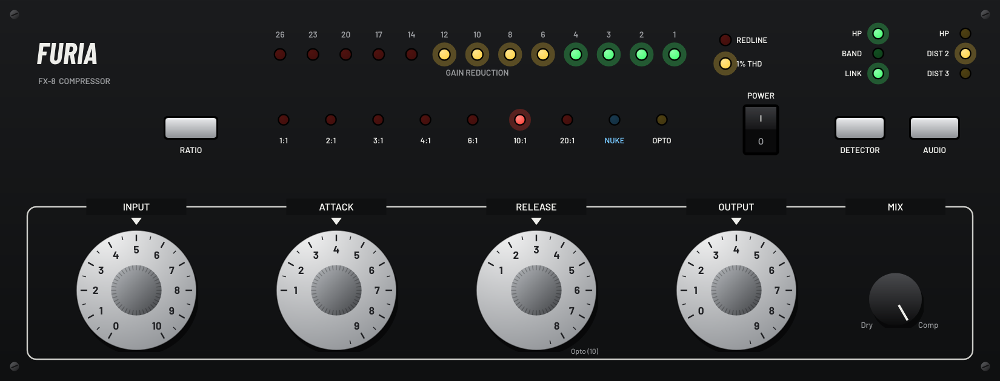

### Qué hace

Es un compresor de carácter. Va de un control casi transparente a una compresión extrema con distorsión, y también sirve **solo para dar color** sin comprimir (ratio 1:1).

### Cómo lo hace

El **Input empuja la señal contra un umbral fijo** (−18 dB): cuanto más input, más compresión. El **Output** compensa el volumen. Es la forma de trabajar de los compresores de hardware de los 90.

### Controles

| Control | Rango y efecto |
|---|---|
| **Input** | 0–10: cuánto se comprime |
| **Attack** | 1–10: de 0,05 ms (aplasta los transitorios) a 30 ms (los deja pasar) |
| **Release** | 1–10: de 50 ms (agresivo, "bombea") a 3,5 s (suave) |
| **Output** | 0–10 (5 = 0 dB): ±20 dB |
| **Mix** | Dry ↔ Comp: compresión en paralelo |
| **RATIO** | 1:1 (solo color), 2, 3, 4, 6, 10, 20, **NUKE** (casi un muro) y **OPTO** (10:1 con release que se alarga con la compresión sostenida) |
| **DETECTOR** | **HP**: el detector ignora los graves (el bombo no hace bombear la mezcla). **BAND**: realza los 6 kHz en el detector (de-esser). **LINK**: enlaza los dos canales |
| **AUDIO** | **HP**: filtro a 80 Hz en el audio. **DIST 2**: 2.º armónico, cálido. **DIST 3**: 3.er armónico, tipo cinta, más agresivo |
| **POWER** | Bypass exacto, con la latencia compensada |

Los botones RATIO, DETECTOR y AUDIO recorren los estados como en el hardware. También puedes hacer clic directamente en cada LED.

**Medición**: la escalera de LEDs marca la reducción de ganancia de 1 a 26 dB. **1% THD** se enciende cuando la distorsión trabaja con nivel; **REDLINE**, cuando la salida roza 0 dBFS.

### Recetas

| Objetivo | Ajuste |
|---|---|
| **Room de batería aplastado** | NUKE, attack 1, release 3, input alto, Mix al 40 % |
| **Bajo con mordida** | 4:1, attack 5, release 4, DIST 2, Detector HP |
| **Voz al frente** | 6:1, attack 4, release 5, 6–10 dB de GR |
| **Solo color, sin comprimir** | 1:1 con DIST 2 o DIST 3; con el Input controlas la cantidad de saturación |
| **De-esser con carácter** | 10:1, attack 1, release 2, Detector BAND |
| **Bus de mezcla suave** | OPTO, attack 6, release 4, 1–3 dB de GR, Mix al 50 % |

---

## Afina

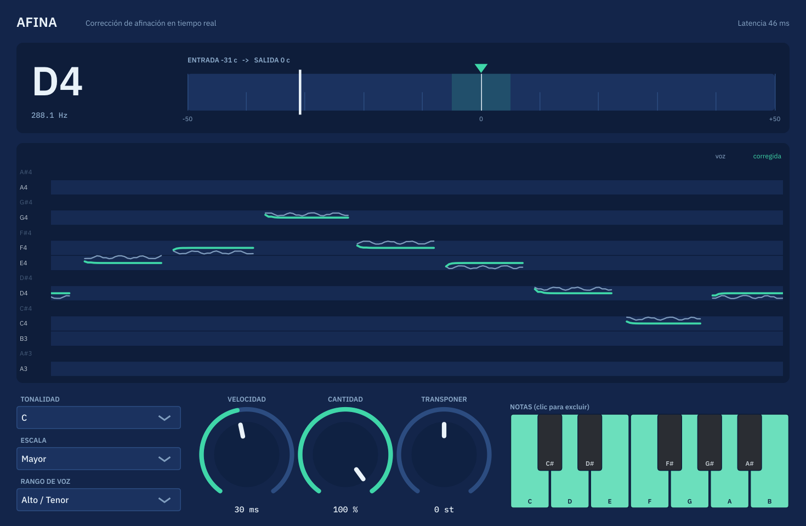

### Qué hace

Corrige la afinación de una voz (o de un instrumento monofónico) en tiempo real: cada nota se lleva a la nota más cercana de la escala elegida. Según la velocidad, va desde una corrección invisible hasta el efecto robótico.

### Cómo lo hace

1. **Detecta** el tono con el algoritmo YIN (de Cheveigné y Kawahara, 2002), con un error de menos de 0,5 cents. Incluye protección contra errores de octava, que es el fallo típico de los detectores cuando un formante coincide con el 2.º armónico.
2. **Decide** la nota objetivo dentro de la escala, desplazándose hacia ella con la velocidad elegida.
3. **Resintetiza** con TD-PSOLA: trocea la voz en granos de dos periodos y los recoloca a la nueva separación. Así **se conservan los formantes**: la voz no suena "a pitufo".
4. El **ataque de cada nota** (los primeros 25 ms) pasa sin corregir, para que las consonantes y los inicios suenen naturales.

### Controles

| Control | Qué hace |
|---|---|
| **Tonalidad / Escala** | Las notas permitidas: cromática, mayor, menor natural, menor armónica, dórica, pentatónicas mayor y menor, blues |
| **Teclado** | Clic en una nota de la escala para **excluirla** (aparece tachada). Útil cuando la melodía evita una nota concreta |
| **Velocidad** | **0 ms**: corrección instantánea, efecto robótico. **20–60 ms**: natural. **Más de 100 ms**: muy sutil; respeta el vibrato y las inflexiones |
| **Cantidad** | Qué parte de la desafinación se corrige (100 % = toda). 50–80 % suena más humano |
| **Transponer** | ±12 semitonos, conservando los formantes: dobles de voz a la octava o a la quinta |
| **Rango de voz** | La nota más grave que se detecta. Fija la latencia: **Soprano ~24 ms** (sirve para monitorizar en directo), Alto/Tenor ~46 ms, Voz grave ~55 ms |

### La pantalla

- **Nota grande**: la nota que está cantando la voz y su frecuencia.
- **Medidor de cents**: la aguja blanca marca la afinación real; la marca de color, la corregida. La franja central es "afinado" (±5 cents).
- **Historial (piano roll)**: la línea gris es lo que canta la voz y la de color, lo que sale. Los carriles de las notas de la escala van resaltados.

### Recetas

| Objetivo | Ajuste |
|---|---|
| **Corrección invisible en una voz principal** | Escala de la canción, velocidad 40–60 ms, cantidad 80 % |
| **Efecto robótico / trap** | Velocidad 0 ms, cantidad 100 %, escala correcta (si no, salta entre notas) |
| **Coros más afinados** | Velocidad 20 ms, cantidad 100 % |
| **Voz doblada a la octava** | En una copia de la pista: transponer −12 o +12 y mezclarla por debajo |

### Limitaciones

- Es **monofónico**: corrige una sola voz. Con acordes o dos voces a la vez el resultado es impredecible.
- En estéreo corrige la suma mono y la envía a ambos canales.
- La edición manual de notas, tipo Melodyne, será **Afina v2**.

---

## Referencia técnica

- Formatos: AU (Mac), VST3 y CLAP (Mac y Windows), además de una aplicación standalone.
- Frecuencias de muestreo: todas las que use el DAW (probadas de 44,1 a 96 kHz).
- Latencia: cada plugin la reporta exacta y el DAW la compensa. Las más altas son el EQ en fase lineal (~176 ms) y Afina (24–55 ms).
- Calidad verificada con tests automáticos (12 conjuntos), por ejemplo: los casos oficiales EBU Tech 3341/3342, el techo true-peak con la cadena completa, el bypass bit a bit, la curva del EQ igual al audio y la precisión de afinación en cents.
